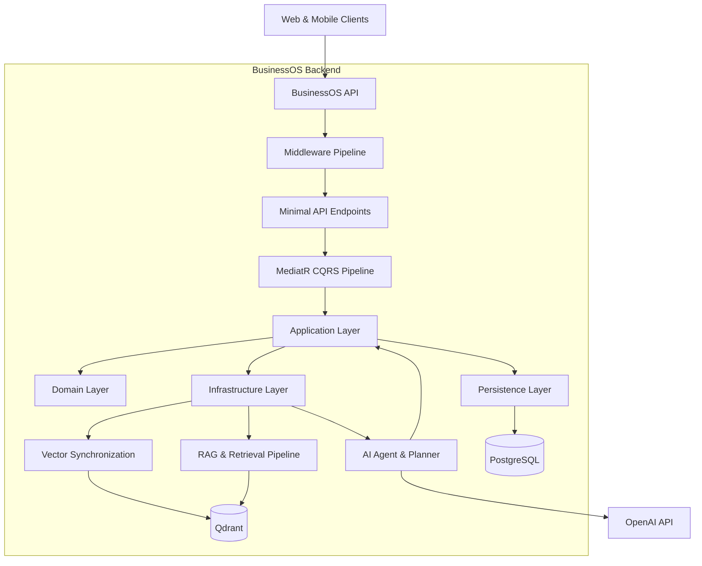

# BusinessOS — AI-Powered Business Operating System

**One platform to manage your business. One intelligent assistant to help you run it.**

BusinessOS is an AI-powered, multi-tenant business management platform designed to help freelancers, startups, agencies, and growing businesses manage their operations from a unified workspace.

From customer relationships and inventory to sales, procurement, invoicing, and financial analytics, BusinessOS brings essential business operations together. Its AI-powered assistant combines tool execution and Retrieval-Augmented Generation (RAG) to help users interact with business information more naturally.

Built with **ASP.NET Core, .NET 10, Angular, PostgreSQL, Qdrant, and OpenAI**, BusinessOS explores how modern enterprise architecture and AI agent capabilities can work together in a practical business application.

---

<!--
PROJECT VISUALS:
Add real screenshots to docs/assets/ before publishing.
Recommended: dashboard, inventory, sales, and AI assistant.
-->

<p align="center">
  
</p>

<p align="center">
  <strong>Manage operations. Understand your data. Work smarter with AI.</strong>
</p>

<p align="center">
  <a href="#-key-features">Features</a> •
  <a href="#-architecture">Architecture</a> •
  <a href="#-technology-stack">Tech Stack</a> •
  <a href="#-getting-started">Getting Started</a> •
  <a href="#-documentation">Documentation</a>
</p>

---

## The Problem We're Solving

Growing businesses often manage inventory, customers, sales, finances, and daily operations across disconnected tools and spreadsheets.

This creates fragmented information, manual work, limited visibility, and difficulty making informed decisions.

**BusinessOS brings these operations into one platform, with an AI assistant that makes business information easier to access and interact with.**

## Key Features

### Business Management

- **Inventory Management** — Organize products, monitor stock, and manage inventory operations.
- **Customer Relationship Management** — Maintain customer information and business relationships.
- **Sales & Order Management** — Manage sales transactions and order workflows.
- **Procurement** — Support purchasing and supplier-related operations.
- **Invoicing & Finance** — Manage invoicing and access financial information.
- **Business Analytics** — Understand business activity through analytics and reporting.

### AI-Powered Business Assistant

BusinessOS integrates an AI assistant designed to interact with business information and support natural-language workflows.

- **AI Tool Execution** — Connect natural-language requests with application capabilities.
- **Retrieval-Augmented Generation (RAG)** — Retrieve relevant business knowledge using vector search.
- **Semantic Search** — Find relevant information based on meaning rather than exact keyword matches.
- **Context-Aware Responses** — Ground responses in available business context.
- **Voice Interaction** — Support voice-based interaction through speech synthesis.

### Enterprise-Oriented Engineering

- Multi-tenant application architecture.
- Authentication with ASP.NET Core Identity and JWT.
- Role-Based Access Control (RBAC) and permission policies.
- Clean Architecture and separation of concerns.
- CQRS-based application workflows.
- Structured logging and centralized error handling.
- Containerized infrastructure with Docker.

---

## AI Architecture

The interesting part of BusinessOS is not simply connecting an LLM to a chat interface.

The goal is to connect AI capabilities with actual application functionality while maintaining application-level authorization and business context.

The AI integration combines:

| Component | Responsibility |
|---|---|
| OpenAI | Language generation and embeddings |
| AI Agent | Interprets requests and coordinates tools |
| RAG Pipeline | Retrieves relevant contextual information |
| Qdrant | Stores and searches vector embeddings |
| Business APIs | Provide application functionality |
| Tenant Context | Supports tenant-scoped business operations |

**Design principle:** AI-generated responses should not replace business logic or server-side authorization. Application permissions and business rules remain the responsibility of the backend.

---

## Architecture

BusinessOS follows Clean Architecture and Domain-Driven Design principles to separate business logic, application workflows, infrastructure, and API delivery.

### High-Level System Architecture



### Architectural Principles

- Separation of concerns through independent application layers.
- Dependency inversion and dependency injection.
- Domain-focused business logic.
- CQRS for separating application commands and queries.
- Middleware-based request processing.
- Centralized exception handling and structured logging.
- Integration boundaries for external AI and infrastructure services.

---

## Technology Stack

| Category | Technologies |
|---|---|
| Backend | ASP.NET Core, .NET 10 Web API |
| Frontend | Angular |
| Architecture | Clean Architecture, DDD, CQRS |
| Application Mediation | MediatR |
| Database | PostgreSQL, Entity Framework Core 10 |
| Vector Database | Qdrant |
| AI & LLM | OpenAI API |
| Embeddings | text-embedding-3-small |
| AI Agent | LLM-based and heuristic tool routing |
| Authentication | ASP.NET Core Identity, JWT |
| Authorization | RBAC, Dynamic Permission Policies |
| Real-Time Communication | SignalR |
| Document Generation | QuestPDF |
| Logging | Serilog |
| Infrastructure | Docker, Docker Compose |

---

## Documentation

BusinessOS includes detailed technical documentation to help developers understand the architecture, implementation, and internal workflows.

| Area | Documentation |
|---|---|
| Documentation Overview | [Documentation Index](docs/README.md) |
| Architecture | [Architecture & Layering](docs/Architecture.md) |
| Project Structure | [Folder Structure](docs/Folder-Structure.md) |
| Request Processing | [Request Lifecycle](docs/Request-Lifecycle.md) |
| Authentication | [Authentication](docs/Authentication.md) |
| Authorization | [Authorization & RBAC](docs/Authorization.md) |
| Dependency Injection | [Dependency Injection](docs/Dependency-Injection.md) |
| Middleware | [Middleware Pipeline](docs/Middleware.md) |
| CQRS | [CQRS & MediatR](docs/CQRS.md) |
| AI Agent | [AI Agent Architecture](docs/AI-Agent.md) |
| RAG | [Retrieval-Augmented Generation](docs/RAG.md) |
| Prompt Engineering | [Prompt Pipeline](docs/Prompt-Pipeline.md) |
| Vector Search | [Qdrant & Vector Search](docs/Vector-Search.md) |
| Database | [Database & Multi-Tenancy](docs/Database.md) |
| Entity Relationships | [ERD & Database Schema](docs/Entity-Relationships.md) |
| Services | [Application Services](docs/Services.md) |
| API Routes | [API Route Reference](docs/Controllers.md) |
| API Workflows | [API Flow Diagrams](docs/API-Flow.md) |
| Configuration | [Configuration Reference](docs/Configuration.md) |
| Logging | [Logging & Audit Trails](docs/Logging.md) |
| Error Handling | [Error Handling](docs/Error-Handling.md) |
| Deployment | [Docker & Deployment](docs/Deployment.md) |
| Business Workflows | [Domain Workflows](docs/Workflows.md) |

---

## Getting Started

Follow these instructions to run the backend locally.

### Prerequisites

Make sure you have:

- [.NET 10 SDK](https://dotnet.microsoft.com/download)
- [Docker Desktop](https://www.docker.com/products/docker-desktop/)
- [Git](https://git-scm.com/)
- An OpenAI API key (for AI functionality)

### 1. Clone the Repository

```bash
git clone https://github.com/aliahsan9/BusinessOS.git

cd BusinessOS
```

### 2. Start Infrastructure

Start the PostgreSQL and Qdrant services configured in Docker Compose.

```bash
docker compose up -d
```

### 3. Configure Application Settings

Configure your local database connection, authentication secret, and AI credentials using environment variables or ASP.NET Core User Secrets.

Example:

```bash
ConnectionStrings__DefaultConnection="your-postgresql-connection-string"

Jwt__Key="your-secure-secret-key-of-at-least-32-characters"

Ai__OpenAiApiKey="your-openai-api-key"
```

Never commit API keys, passwords, JWT secrets, or production connection strings to Git.

### 4. Apply Database Migrations

```bash
dotnet ef database update \
  --project BusinessOS.Infrastructure \
  --startup-project BusinessOS.API
```

### 5. Run the Backend

```bash
dotnet run --project BusinessOS.API
```

The API runs using the configured application URLs.

Open the configured Swagger/OpenAPI endpoint to explore available API operations.

> Note: The commands above assume the project names and migration configuration shown in this repository. Check the actual project structure and Docker Compose configuration before running.

---

## Configuration Reference

| Variable | Purpose |
|---|---|
| `ConnectionStrings__DefaultConnection` | PostgreSQL connection string |
| `Jwt__Key` | JWT signing secret |
| `Ai__OpenAiApiKey` | OpenAI API credential |
| `Qdrant__Host` | Qdrant server hostname |
| `Qdrant__Port` | Qdrant gRPC port |

Keep environment-specific configuration outside source control.

---

## Project Goals & Future Direction

BusinessOS is an evolving project focused on bringing business software and practical AI capabilities together.

Areas of continued development include:

- Improving AI agent reliability and tool-selection accuracy.
- Strengthening tenant isolation and authorization.
- Improving RAG retrieval quality and grounded responses.
- Expanding business analytics and operational insights.
- Improving automated testing, observability, and deployment.
- Enhancing the overall user experience.

---

## About the Developer

BusinessOS is developed by **Ali Ahsan**, a Computer Science student and software developer interested in building scalable backend systems, full-stack applications, and practical AI-powered products.

The project reflects hands-on exploration of:

- Enterprise application architecture with ASP.NET Core.
- Multi-tenant SaaS system design.
- AI agents and tool orchestration.
- Retrieval-Augmented Generation and vector databases.
- Secure API development and backend engineering.

**Interested in collaborating, contributing, or discussing opportunities around BusinessOS and AI-powered software engineering?**

Feel free to connect.

- GitHub: [@aliahsan9](https://github.com/aliahsan9)
- LinkedIn: [Ali Ahsan](https://www.linkedin.com/in/ali-ahsan-6895a9315/)

---

## License

See the repository's [LICENSE.txt](LICENSE.txt) for licensing information.
